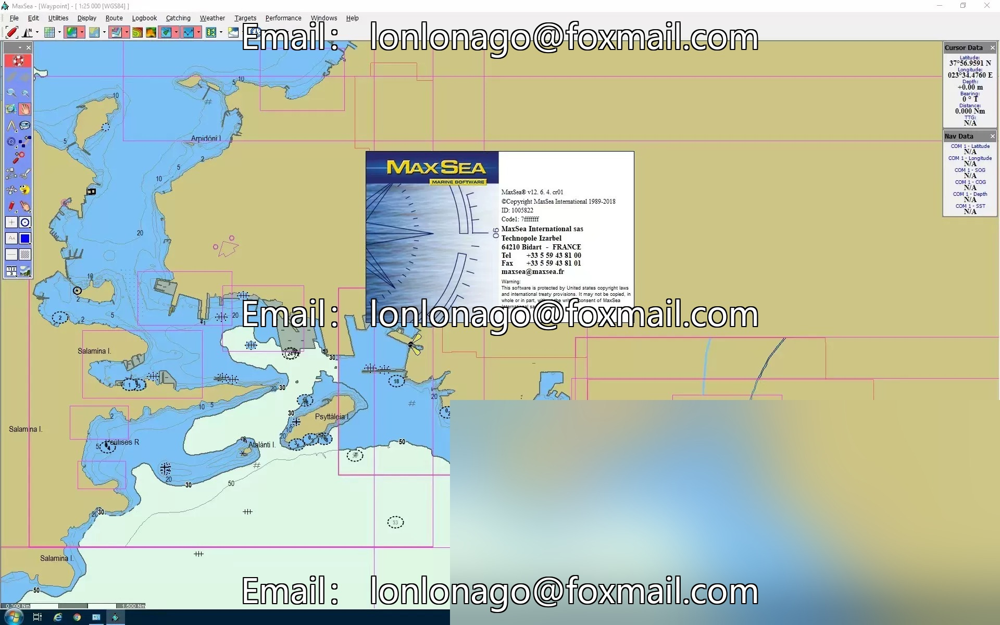

# MaxSea International v12.6.4.1

## Body

MaxSea International v12.6.4.1 Navigation software

Applicable systems: Windows 7 (x64) or Windows 10 (x64)

Multi-format sea chart support: can load mainstream grid/vector sea charts such as Mapmedia, Maptech, ARCS, CM93 v3, as well as 3D water depth charts.

Advanced weather technology: Integrating meteorological data to assist route planning.

Electronic nautical chart display: responsive nautical chart operation and display.

Shipbuilding equipment integration: supports data access to AIS (ship automatic identification system), navigation instruments, etc.

Professional application expansion: supports buoy tracking for commercial fishing, sailing performance route planning, and underwater classification, etc.

Need to take a direct photo, and for any issues, message privately.

MaxSea International v12.6.4.1 navigation software, applicable to Windows 7 (x64) or Windows 10 (x64), supporting multiple charts and weather technologies, electronic chart display, ship equipment integration, and professional applications such as fishing floats and sailboat routing.

<!-- AI_ENRICHED -->

## Images

## Payment

Here is a pay link on Stripe ( https://buy.stripe.com/3cs8yP7sY87d0vu9AB ). Please contact me lonlonago@foxmail.com after funding $89, and I will send you a complete data files , thank you!

